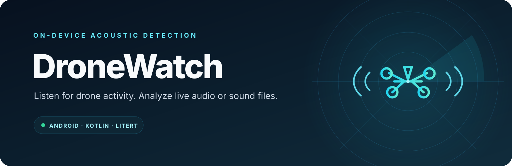

<div align="center">
  
</div>

<div align="center">
  <strong>An Android app for detecting drone-like acoustic signatures from live microphone input or audio files.</strong>
</div>

## Overview

DroneWatch runs a bundled LiteRT audio model on the device. It captures microphone audio in two-second windows for live monitoring, or analyzes an audio file selected from the device. A configurable confidence threshold controls the detection alert. Live monitoring can continue through the foreground microphone service while the app is in the background.

The app is built with Kotlin and Jetpack Compose. Audio capture, preprocessing, and inference run locally; the project does not require a cloud inference service.

## Features

- Live microphone monitoring with an audio activity display
- Classification of audio files selected through Android's document picker
- On-device LiteRT inference using the included best_model4.tflite model
- Adjustable detection threshold and audible alert
- Foreground service for continued monitoring outside the app screen

## Requirements

- Android Studio with Android SDK 37 installed
- JDK 21 (the Gradle wrapper is configured for this Java toolchain)
- Android 7.0 (API 24) or later

## Build and install

1. Clone this repository and open it in Android Studio, or build from a terminal.
2. Allow Gradle to download the required Android and Kotlin dependencies.
3. Build a debug APK:

   ```shell
   ./gradlew assembleDebug
   ```

   On Windows, use gradlew.bat assembleDebug. The APK is written to app/build/outputs/apk/debug/app-debug.apk.
4. Install the APK on a compatible Android device. Grant microphone permission to use live detection.

The current Gradle release build uses the debug signing configuration. Set up a private release keystore and signing configuration before distributing a release build.

## Use

- **Live monitoring:** tap the microphone control and grant the requested microphone permission. Stop monitoring from the same control.
- **Audio file:** choose an audio file in the app to analyze it.
- **Threshold:** adjust the confidence threshold to change how readily the app reports a detection.

Detection results depend on the bundled model and recording conditions. This app is an experimental acoustic classifier; results should not be treated as authoritative identification.

## Project layout

```
app/src/main/java/      Android app, audio pipeline, UI, and LiteRT classifier
app/src/main/assets/    Bundled TensorFlow Lite model
app/src/main/res/       App resources and theme
gradle/                 Version catalog and Gradle wrapper configuration
assets/                 README banner artwork
```

## Model and attribution

The app expects app/src/main/assets/best_model4.tflite. The model is included in this repository because the application requires it to run. Its training data, evaluation results, and redistribution terms are not documented in this checkout; confirm those details before redistributing the model or publishing derivative results.

## License

No project license is included yet. Unless a license is added, the source and bundled model remain subject to their respective rights holders' terms.
